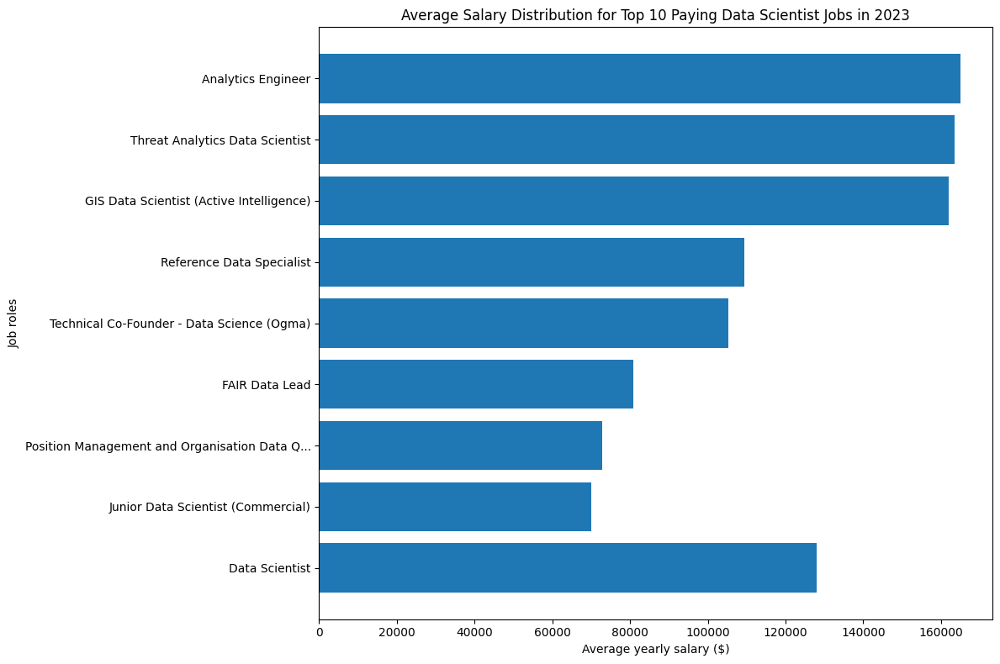
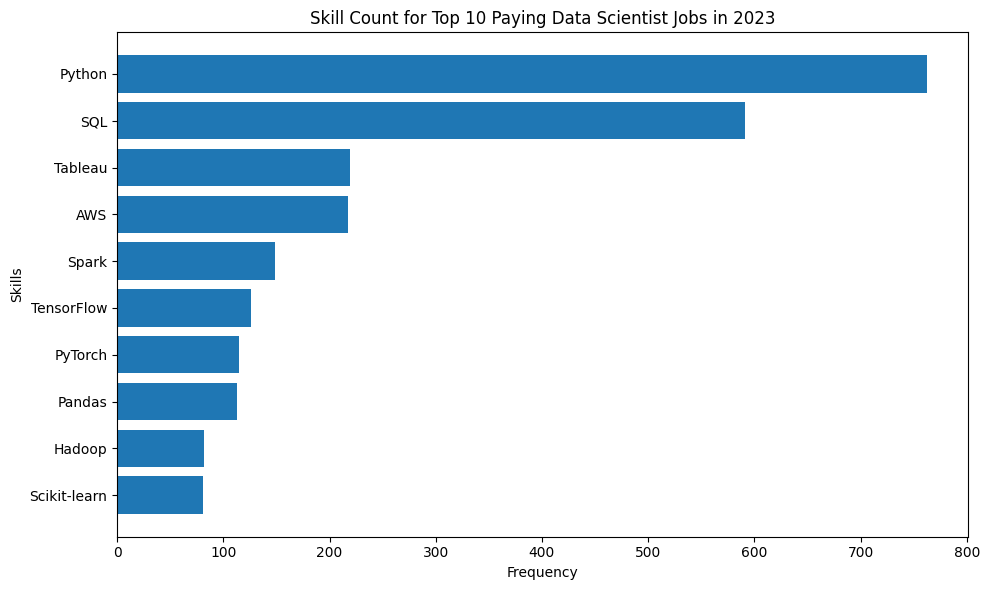

# Introduction
Dive into the Data Scientist job market! This project explores the highest-paying Data Scientist jobs, in-demand skills, and the skills that offer the best earning potential. Using SQL, I analysed job postings to uncover salary trends, identify valuable skills, and understand where high demand meets high salary in Data Science.

**SQL queries:** Check them out here: [project_sql folder](/project_sql/)

# Background

Driven by a desire to understand the Data Scientist job market and identify the skills that can help aspiring professionals make informed career decisions, this project explores the relationship between job opportunities, salaries, and technical skills.

The data comes from my [SQL Course](https://lukebarousse.com/sql). It contains valuable information on job titles, salaries, locations, companies, and the skills required by employers.

### The questions I wanted to answer through my SQL queries were:

1. What are the highest-paying Data Scientist jobs in the United Kingdom?
2. What skills are required for these highest-paying jobs?
3. What skills are most in demand for Data Scientists?
4. Which skills are associated with higher salaries?
5. What are the most optimal skills to learn, considering both demand and salary?

# Tools I Used
For my analysis of the Data Scientist job market, I used several key tools:

- **SQL:** The foundation of my analysis, allowing me to query, filter, join, and analyse job posting data to uncover important insights.
- **PostgreSQL:** The database management system used to store and query the job market dataset.
- **Visual Studio Code:** My development environment for writing and executing SQL queries.
- **Git & GitHub:** Essential for version control and sharing my SQL scripts and analysis, while tracking project changes.

# The Analysis

Each query for this project was designed to investigate specific aspects of the Data Scientist job market. Here's how I approached each question:

### 1. Top-Paying Data Scientist Jobs

To identify the highest-paying Data Scientist roles, I filtered job postings in the United Kingdom by average yearly salary, excluding jobs without specified salary information. This query highlights the highest-paying opportunities in the field.

```sql
SELECT
    job_id,
    job_title,
    job_location,
    job_schedule_type,
    salary_year_avg,
    job_posted_date,
    name AS company_name
FROM
    job_postings_fact
LEFT JOIN company_dim
    ON job_postings_fact.company_id = company_dim.company_id
WHERE
    job_title_short = 'Data Scientist'
    AND job_location = 'United Kingdom'
    AND salary_year_avg IS NOT NULL
ORDER BY
    salary_year_avg DESC
LIMIT 10;
```
Here's the breakdown of the top Data Scientist jobs in the UK in 2023:
- **Wide Salary Range:** The top 10 jobs range from 65,000 to 165,000 in average yearly salary, indicating strong earning potential across different roles.
- **Diverse Employers:** Companies like Deliveroo, Deutsche Bank, BT Group, Philips, and Rolls-Royce feature among the highest-paying employers.
- **Variety of Job Titles:** Roles range from Analytics Engineer and Threat Analytics Data Scientist to GIS Data Scientist and FAIR Data Lead, reflecting the different specialisations within the Data Science field.


*Bar graph visualizing the salary for the top 10 salaries for data scientists; ChatGPT generated this graph from my SQL query results*


### 2. Skills Required for Top-Paying Data Scientist Jobs

To understand the skills associated with high-paying opportunities, I identified the skills required for the top 10 highest-paying Data Scientist jobs.

```sql
WITH top_paying_jobs AS (
SELECT
job_id,
job_title,
salary_year_avg,
name AS company_name
FROM
job_postings_fact
LEFT JOIN company_dim ON job_postings_fact.company_id = company_dim.company_id
WHERE
job_title_short = 'Data Scientist' AND
job_location = 'United Kingdom' AND
salary_year_avg IS NOT NULL
ORDER BY
salary_year_avg DESC
LIMIT 10
)

SELECT 
top_paying_jobs.*,
skills
FROM top_paying_jobs
INNER JOIN skills_job_dim ON top_paying_jobs.job_id = skills_job_dim.job_id
INNER JOIN skills_dim ON skills_job_dim.skill_id = skills_dim.skill_id
ORDER BY
salary_year_avg DESC
```

Here's the breakdown of the most requested skills:
- **Python and SQL Dominance:** Python leads with 763 mentions, followed by SQL with 591, highlighting the importance of programming and database querying.
- **Cloud and Data Visualisation:** Tableau and AWS follow with 219 and 217 mentions respectively, showing the relevance of visualisation and cloud technologies.
- **Machine Learning Tools:** TensorFlow, PyTorch, and Scikit-learn feature among the top 10 skills, highlighting the importance of machine learning expertise.


*Bar graph visualizing the count of skills for the top 10 paying jobs for data scientists; ChatGPT generated this graph from my SQL query results*

### 3. Most In-Demand Data Scientist Skills

To identify the skills employers request most frequently, I analysed Data Scientist job postings and ranked skills based on how often they appeared across job listings.

```sql
SELECT 
skills,
COUNT (skills_job_dim.job_id) AS demand_count
FROM job_postings_fact
INNER JOIN skills_job_dim ON job_postings_fact.job_id = skills_job_dim.job_id
INNER JOIN skills_dim ON skills_job_dim.skill_id = skills_dim.skill_id
WHERE 
job_title_short = 'Data Scientist' AND
job_work_from_home = True 
GROUP BY
skills
ORDER BY
demand_count DESC
LIMIT 5;
```
Here's the breakdown of the most demanded skills for Data Scientists in 2023:
- **Python and SQL Lead:** Python ranks first with 10,390 mentions, followed by SQL with 7,488, highlighting their importance as foundational skills for Data Scientist roles.
- **Cloud and Statistical Computing:** R ranks third with 4,674 mentions, while AWS and Tableau also feature among the top five, showing the importance of statistical programming, cloud computing, and data visualisation.

| Skills | Demand Count |
|:---|---:|
| python | 10390 |
| Sql | 7488 |
| r | 4674 |
| aws | 2593 |
| tableau | 2458 |

*Table of the demand for the top 5 skills in Data Scientist job postings.*

### 4. Highest-Paying Skills for Data Scientists

To identify the highest-paying skills, I calculated the average yearly salary associated with each skill across Data Scientist job postings with specified salary information.

```sql
SELECT 
skills,
ROUND(AVG(salary_year_avg), 0) AS avg_salary
FROM job_postings_fact
INNER JOIN skills_job_dim ON job_postings_fact.job_id = skills_job_dim.job_id
INNER JOIN skills_dim ON skills_job_dim.skill_id = skills_dim.skill_id
WHERE 
job_title_short = 'Data Scientist' 
AND salary_year_avg IS NOT NULL
AND job_work_from_home = True 
GROUP BY
skills
ORDER BY
avg_salary DESC
LIMIT 30;
```
Here's the breakdown of the top 30 highest-paying skills for Data Scientists in 2023:
- **Highest-Paying Skill:** GDPR ranks first with an average salary of 217,738, followed by Golang at 208,750.
- **Specialised Technologies:** OpenCV, Neo4j, DataRobot, and Solidity feature among the highest-paying skills.
- **Diverse Technical Skills:** Programming languages, data infrastructure tools, and business intelligence platforms such as Rust, BigQuery, Airflow, Qlik, and Looker also feature prominently.

| Skills | Average Yearly Salary ($) |
|:---|---:|
| GDPR | 217,738 |
| Golang | 208,750 |
| Atlassian | 189,700 |
| Selenium | 180,000 |
| OpenCV | 172,500 |
| Neo4j | 171,655 |
| MicroStrategy | 171,147 |
| DynamoDB | 169,670 |
| PHP | 168,125 |
| Tidyverse | 165,513 |
| Solidity | 165,000 |
| C | 164,865 |
| Go | 164,691 |
| DataRobot | 164,500 |
| Qlik | 164,485 |
| Redis | 162,500 |
| Watson | 161,710 |
| Elixir | 161,250 |
| Rust | 161,250 |
| Cassandra | 160,850 |
| Looker | 158,715 |
| Slack | 158,333 |
| Terminal | 157,500 |
| Airflow | 157,414 |
| Julia | 157,244 |
| BigQuery | 157,142 |
| Scala | 156,702 |
| Hugging Face | 156,520 |
| Node.js | 156,107 |
| Vue | 156,107 |

*Table of the top 30 skills ranked by average yearly salary in Data Scientist job postings.*

### 5. Most Optimal Skills to Learn for Data Scientists

To identify the most optimal skills to learn, I combined skill demand and average salary data to find skills that offer a balance between strong employer demand and high earning potential.

```sql
SELECT
skills_dim.skill_id,
skills_dim.skills,
COUNT(skills_job_dim.job_id) AS demand_count,
ROUND(AVG(job_postings_fact.salary_year_avg), 0) AS avg_salary
FROM job_postings_fact
INNER JOIN skills_job_dim ON job_postings_fact.job_id = skills_job_dim.job_id
INNER JOIN skills_dim ON skills_job_dim.skill_id = skills_dim.skill_id
WHERE
job_title_short = 'Data Scientist'
AND salary_year_avg IS NOT NULL
AND job_work_from_home = True
GROUP BY
skills_dim.skill_id
HAVING
COUNT(skills_job_dim.job_id) > 10
ORDER BY
avg_salary DESC,
demand_count DESC
LIMIT 30;
```
| Skill ID | Skills | Demand Count | Average Yearly Salary |
|---:|:---|---:|---:|
| 26 | C | 48 | 164,865 |
| 8 | Go | 57 | 164,691 |
| 187 | Qlik | 15 | 164,485 |
| 185 | Looker | 57 | 158,715 |
| 96 | Airflow | 23 | 157,414 |
| 77 | BigQuery | 36 | 157,142 |
| 3 | Scala | 56 | 156,702 |
| 81 | GCP | 59 | 155,811 |
| 80 | Snowflake | 72 | 152,687 |
| 101 | PyTorch | 115 | 152,603 |
| 78 | Redshift | 36 | 151,708 |
| 99 | TensorFlow | 126 | 151,536 |
| 233 | Jira | 22 | 151,165 |
| 92 | Spark | 149 | 150,188 |
| 76 | AWS | 217 | 149,630 |
| 94 | NumPy | 73 | 149,089 |
| 106 | Scikit-learn | 81 | 148,964 |
| 95 | PySpark | 34 | 147,544 |
| 182 | Tableau | 219 | 146,970 |
| 2 | NoSQL | 31 | 146,110 |
| 4 | Java | 64 | 145,706 |
| 196 | PowerPoint | 23 | 145,139 |
| 93 | Pandas | 113 | 144,816 |
| 213 | Kubernetes | 25 | 144,498 |
| 1 | Python | 763 | 143,828 |
| 108 | Matplotlib | 40 | 143,824 |
| 18 | MongoDB | 19 | 143,335 |
| 62 | MongoDB | 19 | 143,335 |
| 97 | Hadoop | 82 | 143,322 |
| 0 | SQL | 591 | 142,833 |

*Table showing the top 30 skills ranked by average yearly salary, with demand counts for remote Data Scientist job postings.*


# What I Learned

Working on this project helped me strengthen my SQL skills and gain a better understanding of how to analyse real-world job market data.

Some of the key things I learned include:

- **Writing SQL Queries:** Improved my ability to write SQL queries using SELECT, WHERE, GROUP BY, ORDER BY, and LIMIT to retrieve and organise relevant data.
- **Working with Joins:** Gained practical experience joining multiple tables to combine job postings, company information, and required skills.
- **Data Aggregation:** Used aggregate functions such as COUNT and AVG to measure skill demand and calculate average salaries.
- **Filtering and Sorting Data:** Learned how to apply multiple conditions to focus on specific job categories, locations, remote opportunities, and salary information.
- **Extracting Insights:** Developed the ability to interpret query results and identify patterns that can support informed career decisions.

# Conclusion

### Insights

This project provided useful insights into the Data Scientist job market and the skills associated with salary and employer demand.

- **Python and SQL are essential:** They appeared consistently among the most in-demand skills, reinforcing their importance as foundational tools for Data Scientists.
- **Specialised skills offer strong earning potential:** Skills such as C, Go, GCP, PyTorch, and TensorFlow featured among the higher-paying skills in the analysis.
- **Cloud and machine learning technologies matter:** AWS, GCP, Spark, Snowflake, and machine learning libraries featured prominently, highlighting the value of developing skills beyond basic programming.
- **Demand and salary are not always the same:** Some skills had higher average salaries despite appearing in fewer job postings, while widely requested skills such as Python and SQL remained highly relevant.

### Closing Thoughts

Overall, this project helped me understand the relationship between technical skills, job demand, and earning potential in the Data Science field. It also reinforced the importance of building a strong foundation in programming, databases, statistics, and data analysis while gradually developing specialised skills.

Beyond strengthening my SQL knowledge, this project has given me a more practical perspective on the skills employers look for and the areas worth focusing on as I continue my journey into Data Science.